# Photo Backup Flow

This is the deployment model. Confirm the container is running separately;
having these files in the repository does not mean the service is deployed.

```mermaid
flowchart LR
    phone["Android / Poco X7 Pro<br/>FolderSync"]
    network["Home LAN or Tailscale"]
    sftp["Raspberry Pi:2222<br/>Docker: photo-backup-sftp<br/>SFTP over SSH"]
    upload["Restricted SFTP directory<br/>/upload"]
    nvme["NVMe inbox<br/>/mnt/nvme/photos/inbox/poco-x7-pro"]
    verify["Future import workflow<br/>File verification and hash comparison"]
    library["Photo library"]
    duplicates["Duplicate quarantine<br/>Keep files; do not delete"]
    backup["Independent backup<br/>Different storage device"]

    phone --> network
    network -->|Encrypted SSH session / public key| sftp
    sftp --> upload
    upload --> nvme
    nvme -. Planned .-> verify
    verify -. Unique .-> library
    verify -. Duplicate .-> duplicates
    library -. Planned .-> backup
```

## Transport and authentication

SFTP runs over SSH and encrypts authentication and file contents between the
phone and the Pi, including on the home LAN. HTTPS would be appropriate for a
WebDAV or HTTP upload service. This endpoint speaks SFTP, so it does not need
TLS certificates or an HTTP reverse proxy.

FolderSync connects to TCP port `2222` with the `photo-backup` account and an SSH
private key. Only the matching public key is installed on the Pi. Verify the
container's persistent host-key fingerprint before trusting the first
connection, as described in [README.md](README.md). Administrative SSH remains
on port `22` and uses a separate host key.

Use the home LAN or Tailscale; do not forward port `2222` on the public router.
Restrict the published address through `photo_backup_bind_address` if needed.

## File lifecycle

1. Configure FolderSync for one-way uploads to `/upload`.
2. The container authenticates the key and restricts the session to its SFTP
   directory, without an interactive shell.
3. Files written to `/upload` reach the NVMe inbox through the bind mount.
   Provisioning requires the NVMe filesystem. Files live outside the image and
   survive container replacement.
4. Check uploads before deleting originals. Disable remote deletion, two-way
   synchronization, and move-after-sync on the phone.
5. File verification, hash-based deduplication, duplicate quarantine, and
   copying to independent storage are planned steps, not features of this
   SFTP container. Keep duplicate files rather than deleting them automatically.

Another directory on the same NVMe is not an independent backup. Retain a copy
on another storage device before making the inbox the only source.

## Runtime checks

The container has a 128 MiB memory limit, a 96 MiB reservation, and a 32-process
limit. Docker rotates logs across three files of up to 5 MiB each. The health
check tests the SSH listener; an authenticated upload and download comparison
are still needed to verify the full phone-to-NVMe path.

See [README.md](README.md) for provisioning, key setup, logs, and FolderSync
configuration.
